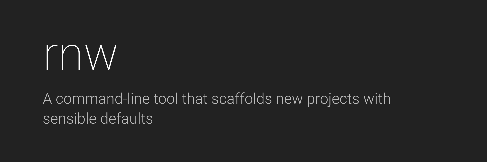

<p align="center"></p>
<p align="center"><strong>A command-line tool that scaffolds new projects with sensible defaults</strong></p>
<p align="center"><a href="LICENSE"></a> <a href="https://github.com/conao3/rust-rnw/stargazers"></a></p>
<p align="center"><a href="#installation">Installation</a> | <a href="#usage">Usage</a> | <a href="#contributing">Contributing</a> | <a href="#license">License</a></p>
<h1>rnw</h1>

A general-purpose project generator written in Rust.

## Overview

rnw is a command-line tool that helps you quickly scaffold new projects with sensible defaults and best practices.

## Installation

### From crates.io

```bash
cargo install rnw
```

### From source

```bash
git clone https://github.com/conao3/rust-rnw.git
cd rust-rnw
cargo install --path .
```

## Usage

```bash
rnw
```

Follow the interactive prompts to generate your project.

## Contributing

Contributions are welcome. Feel free to open issues for bug reports, feature requests, or questions. Pull requests are appreciated.

## License

Apache License 2.0

Copyright (c) Naoya Yamashita

See [LICENSE](LICENSE) for details.

## Author

Naoya Yamashita ([@conao3](https://github.com/conao3))
